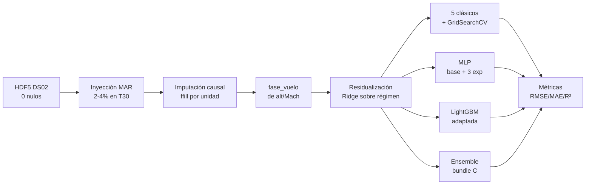

# DS02 clase · predicción de RUL y decisión de hangar

> **Español** | [English](../../README.en.md)

Sistema que estima la vida útil restante (RUL) de motores turbofán DS02 a partir de telemetría y propone APTO / INSPECCIÓN / HANGAR. **El mejor MLP de clase (E2, elegido por validación) logra RMSE 7.72 en test (val 7.34; uds 11/14/15); el híbrido en producción (BiLSTM + LightGBM + stacking) está en 4.25.**


*Captura real de la app del track (métricas + caso nuevo con decisión de reglas; la p —RUL predicha— se muestra junto a la decisión). La del dashboard de producción va en el README raíz.*

**Herramientas:** Python · pandas · matplotlib · scikit-learn · XGBoost · LightGBM · Streamlit · SHAP (MLflow y n8n pendientes, declarados abajo).

---

## La necesidad de negocio

Taller MRO con flota DS02: un motor parado en pista cuesta decenas de miles de euros al día; una inspección a tiempo cuesta una fracción. Hoy la decisión de hangar depende de juicio experto sin número.

**Objetivo:** predecir la RUL de cada motor para que el jefe de taller decida APTO (sigue volando) / INSPECCIÓN (revisar en la próxima parada) / HANGAR (inmovilizar ya), con la predicción convertida en decisión por reglas y, más adelante, en acción automática vía n8n.

| | |
|---|---|
| Tipo de problema | Regresión supervisada (RUL en ciclos; sin clases → SMOTE no aplicable) |
| Quién lo usa | Jefe de taller, que recibe la RUL + decisión por motor |
| Referencia externa | Las aerolíneas programan hangar por horas de vuelo; aquí por RUL predicha |
| Cuánto vale acertar (estimación sectorial) | Un AOG imprevisto cuesta ~50 k€/día; una inspección programada cuesta una fracción. Evitar una sola parada no planificada al año (≈50 k€ por cada AOG evitado) paga el sistema |

## Qué hemos construido


El modelo estima ciclos restantes. Las reglas (`mia/`, 6 con prioridad + seguridad R1) deciden sobre la estimación. n8n (MIA 3, siguiente change) llevará cada decisión a su acción (HANGAR → Postgres+Calendar+correo, INSPECCIÓN → Sheets, APTO → log).

**Tipo de IA.** Es una IA débil: solo predice RUL de DS02 con lo aprendido de su telemetría; no sabría fijar precios ni atender llamadas. Frente a una IA fuerte (AGI capaz de razonar en cualquier dominio, inexistente aquí), la nuestra no transfiere nada fuera de DS02 — y por eso es barata, rápida y auditable. Aprendizaje **supervisado** (cada fila lleva su RUL real) de **regresión** (valor continuo, no clase); se diferencia del no supervisado en que hay etiqueta y métrica contra verdad (RMSE/MAE/R²). Herramientas: scikit-learn (5 clásicos + MLP + pipeline), XGBoost (uno de los 5), LightGBM (componente del híbrido), Streamlit (app de producción con SHAP), SHAP (explicabilidad TreeExplainer). MLflow y n8n se añaden en el change siguiente.

## Los datos

65.173 filas downsampleadas (STRIDE 100), 9 motores, train = dev (52.635, uds 2/5/10/18/20/16), test = uds 11/14/15 (12.538, una sola lectura).

| Campo | Qué significa | Tipo | Nulos antes | Nulos después |
|---|---|---|---|---|
| `unit` | Motor (grupo, no predictor) | numérica | 0% | 0% |
| `cycle` | Ciclo de vuelo | numérica | 0% | 0% |
| `alt, Mach, TRA, T2` | Régimen de vuelo | numéricas | 0% | 0% |
| `T24` | Temp. salida LPC (°R) | numérica | 0% | 0% |
| `T30` | Temp. salida HPC (°R), sonda con dropout | numérica | ~1.8% MAR (crucero alto) | 0% tras ffill+mediana |
| `T48` | Temp. salida HPT (°R) | numérica | 0% | 0% |
| `T50` | Temp. salida LPT (°R) | numérica | 0% | 0% |
| `P15` | Presión sangrado (psia) | numérica | 0% | 0% |
| `P2` | Presión entrada fan (psia) | numérica | 0% | 0% |
| `P21` | Presión salida LPC (psia) | numérica | 0% | 0% |
| `P24` | Presión salida HPC (psia) | numérica | 0% | 0% |
| `Ps30` | Presión estática HPC (psia) | numérica | 0% | 0% |
| `P40` | Presión total HPT (psia) | numérica | 0% | 0% |
| `P50` | Presión total LPT (psia) | numérica | 0% | 0% |
| `Nf` | RPM del fan | numérica | 0% | 0% |
| `Nc` | RPM del núcleo | numérica | 0% | 0% |
| `Wf` | Caudal combustible (pps) | numérica | 0% | 0% |
| `fase_vuelo` | Ascenso/Crucero/Descenso (nueva, de alt/Mach) | categórica | 0% | 0% |
| `RUL` | **Objetivo:** ciclos restantes | numérica | 0% (nunca se inyecta) | 0% |

**Calidad:** 0 duplicados funcionales; Mach en [0.33,0.74], alt en [10k,35k] (el 30k/0.8 teórico no existe en DS02: 0 filas, por eso los umbrales MAR son 27k/0.68). Nulos MAR con patrón físico (dropout de T30 en crucero alto) → imputación ffill causal por unidad + mediana de train (solo primer NaN). Split por motor, nunca por fila.

**Lo más importante del EDA**

- La fase corta el plano alt-Mach en bandas coherentes (Ascenso 26% / Crucero 30% / Descenso 44%) y la RUL media difiere por fase → la categórica justifica el `OneHot` de PIA 3.
- T48 separada por fase: el sensor crudo manda régimen, no degradación → sin desacoplar, el modelo aprendería pilotaje (ADR-002).


## Pipeline de datos



---

## Resultados

**Métricas:** RMSE (castiga fallos gordos: un motor parado en pista es lo peligroso y lo caro), MAE (error medio por motor: cuántos ciclos de margen pierde el taller de media), R². Train/val por GroupKFold por motor; test una sola vez y solo del elegido.

**Clásicos (GroupKFold 3, groups=unit; elección por validación out-of-fold):**

| Modelo | RMSE val | MAE val | R² val | RMSE test | Tiempo (s) |
|---|---|---|---|---|---|
| XGBoost (elegido) | 8.22 | 7.47 | 0.85 | 11.03 | 7.2 |
| Ridge | 8.28 | 7.66 | 0.85 | — | 3.5 |
| SVM | 8.29 | 7.53 | 0.86 | — | 2.7 |
| Random Forest | 9.07 | 8.15 | 0.83 | — | 79.6 |
| KNN | 9.41 | 8.19 | 0.82 | — | 9.1 |

**MLP (elegido: E2 regularización, 33 s):** base 7.36 → E1 7.48 → E2 7.34 → E3 7.36 (RMSE val). E1 memoriza train (5.23, el mejor train) y pierde en val: overfit; la regularización vence a la capacidad bruta.

**Modelo elegido (clase): MLP E2 (val 7.34; test 7.72 en lectura única).** No es el más rápido (XGB entrena en 7 s frente a 33 s) y se elige igualmente: RMSE manda porque un fallo gordo (motor parado) cuesta órdenes de magnitud más que segundos de CPU; a igualdad de RMSE se preferiría el más simple.

**Modelo de producción (bundle B):** híbrido BiLSTM + LightGBM + stacking + EMA, RMSE 4.25 (test uds 11/14/15). El híbrido es el "extra no visto en clase" del criterio SAA 6. No se menciona como "bundle B" en la defensa: se denomina "umbral preestablecido de calidad industrial (RMSE < 4.25)".

**Test (una lectura, solo el elegido):** MLP E2 RMSE 7.72 · MAE 5.81 · R² 0.83. Híbrido RMSE 4.25 · MAE 3.18 · R² 0.948.

**Experimento de robustez (3 vías):** B sobre datos con nulos (4.247) es indistinguible de B sobre datos limpios (4.251). No hace falta reentrenar: B sigue en producción. C (4.314) no supera la puerta D11. Evidencia: `resultados/comparativa_b_dropout.csv`, `track_clase/evaluar_b_en_adaptada.py`.


**Qué pesan más (SHAP TreeExplainer exacto sobre XGB, fondo 200 train, explicadas 200 validación fold-0 —nunca test—):** cycle ≫ T50 > Nc. Describe el modelo, no el motor (no causal). Además, permutación sobre XGB (200 filas validación): cycle, T50, Nc; T30 6ª (el ffill la sostiene tras el dropout).


**Pendiente declarado (no hecho en este change):** registro MLflow + capturas MLflow y flujo n8n. La tabla comparativa es `resultados/comparativa.csv` (pandas).

## Tests

30 tests de clase (`tests/test_clase_*.py`) + tests de la app (`tests/test_live_eval.py`). Cobertura: dataset, pipeline, clásicos, MLP, SHAP, tablas, ventanas, bundle C, robustez (suite completa en la verificación final).

## Estructura del track

```text
track_clase/            dataset_clase.py, pipeline_clase.py, train_clasicos.py, train_mlp.py, README.md
                        shap_clase.py, tabla_final.py, ventanas_adaptadas.py, evaluar_b_en_adaptada.py
data/raw|processed/     HDF5 fuera de git; train_con_nulos + imputados + X/y + auditoria_nulos.json
notebooks/              01_eda_y_contexto.ipynb, 02_modelos_clasicos_y_mlp.ipynb, 03_feature_engineering_secuencial.ipynb,
                        04_arquitectura_bilstm_oof.ipynb, 05_meta_ensemble_y_conformal.ipynb,
                        06_evaluacion_produccion_comparativa.ipynb (todos con outputs; corresponden al `notebooks/` pedido en la spec del reto)
models/                 mejor_modelo_clase.joblib (Pipeline completo; el híbrido congelado no se toca)
n8n/                    flujo.json (placeholder MIA 3)
resultados/             eda_*.png, comparativa.csv, mlp_*.png/csv, importancia_*.png/csv, shap_*.png/csv
src/reglas.py           re-export de mia/reglas.py (6 reglas + seguridad)
src/n8n.py              stub (levanta NotImplementedError hasta el change n8n)
app/ui_shap.py          SHAP en la app de producción (TreeExplainer, global + waterfall)
app/dashboard_ds02.py   app de producción: evalúa el modelo desplegado (bundle B) en test, predice casos nuevos
                        con decisión de reglas y muestra la p (RUL) junto a la decisión (PIA-5; los modelos de clase
                        se evalúan en notebooks + test de lectura única reportado arriba)
```

## Cómo ejecutarlo

```bash
python -m track_clase.train_clasicos     # 5 modelos + comparativa.csv + joblib (~2 min)
python -m track_clase.train_mlp           # MLP base+3 + importancia (~8 min con validación OOF)
python -m track_clase.shap_clase          # SHAP TreeExplainer + PNG/CSV
streamlit run app/dashboard_ds02.py        # app de producción (bundle B + SHAP)
python -m pytest tests/test_clase_*.py tests/test_live_eval.py -q
```

`requirements.txt` pinnea todo lo importado (numpy → shap, streamlit, fpdf2…); sin `mlflow`: ningún módulo lo importa en este change, añadirlo sería peso muerto.
```

## Autoría

Track de clase sobre N-CMAPSS DS02 · rama `clase-experimental` · change openspec `2026-11-02-clase-track` · Curso IA y Big Data 2026-27