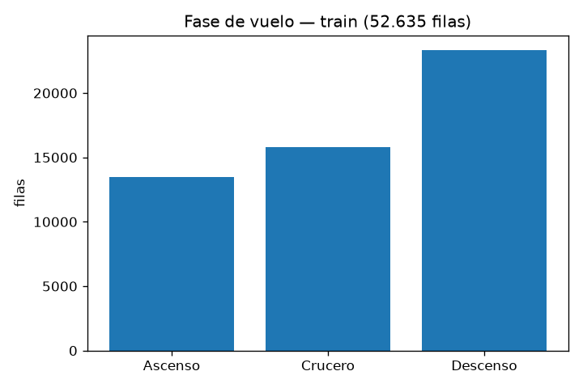
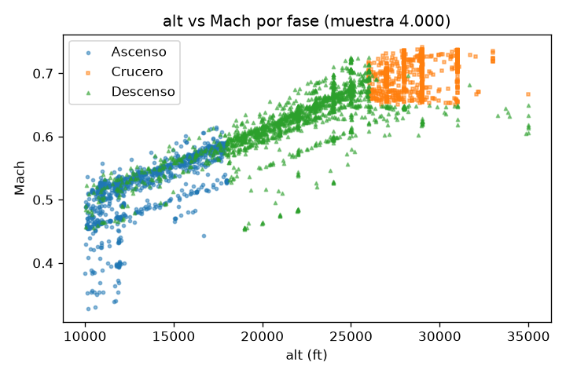
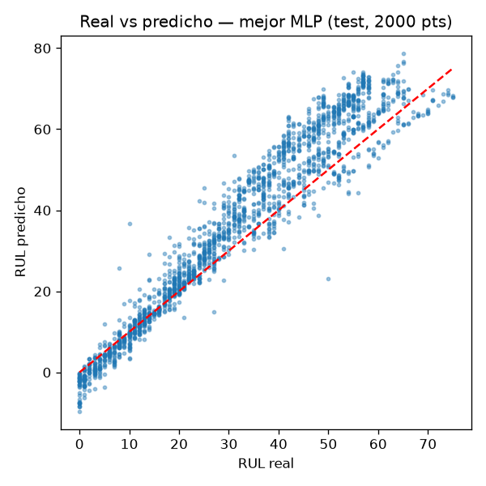
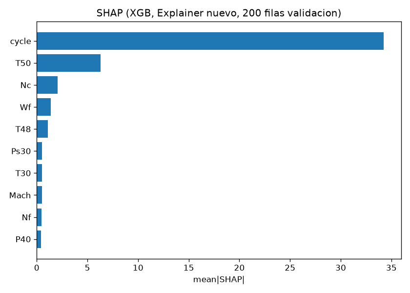
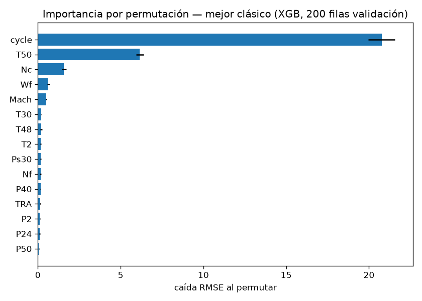

# DS02 clase · predicción de RUL y decisión de hangar

> **Español** | [English](../../README.md)

Sistema que estima la vida útil restante (RUL) de motores turbofán DS02 a partir de telemetría y propone APTO / INSPECCIÓN / HANGAR. **El mejor MLP de clase logra RMSE 7.70 en test (uds 11/14/15); el híbrido en producción (BiLSTM + LightGBM + stacking) está en 4.25.**


**Herramientas:** Python · pandas · matplotlib · scikit-learn · XGBoost · LightGBM · Streamlit · SHAP (MLflow y n8n pendientes, declarados abajo).

---

## La necesidad de negocio

Taller MRO con flota DS02: un motor parado en pista cuesta decenas de miles de euros al día; una inspección a tiempo cuesta una fracción. Hoy la decisión de hangar depende de juicio experto sin número.

**Objetivo:** predecir la RUL de cada motor para que el jefe de taller decida APTO (sigue volando) / INSPECCIÓN (revisar en la próxima parada) / HANGAR (inmovilizar ya), con la predicción convertida en decisión por reglas y, más adelante, en acción automática vía n8n.

| | |
|---|---|
| Tipo de problema | Regresión supervisada (RUL en ciclos; sin clases → SMOTE no aplicable) |
| Quién lo usa | Jefe de taller, que recibe la RUL + decisión por motor |
| Referencia externa | Las aerolíneas programan hangar por horas de vuelo; aquí por RUL predicha |

## Qué hemos construido


El modelo estima ciclos restantes. Las reglas (`mia/`, 6 con prioridad + seguridad R1) deciden sobre la estimación. n8n (MIA 3, siguiente change) llevará cada decisión a su acción (HANGAR → Postgres+Calendar+correo, INSPECCIÓN → Sheets, APTO → log).

**Tipo de IA.** Es una IA débil: solo predice RUL de DS02 con lo aprendido de su telemetría; no sabría fijar precios ni atender llamadas. Ventaja: barata, rápida y auditable. Aprendizaje **supervisado** (cada fila lleva su RUL real) de **regresión** (valor continuo, no clase); se diferencia del no supervisado en que hay etiqueta y métrica contra verdad (RMSE/MAE/R²). Herramientas: scikit-learn (5 clásicos + MLP + pipeline), XGBoost (uno de los 5), LightGBM (componente del híbrido), Streamlit (app de producción con SHAP), SHAP (explicabilidad TreeExplainer). MLflow y n8n se añaden en el change siguiente.

## Los datos

65.173 filas downsampleadas (STRIDE 100), 9 motores, train = dev (52.635, uds 2/5/10/18/20/16), test = uds 11/14/15 (12.538, una sola lectura).

| Campo | Qué significa | Tipo | Nulos antes | Nulos después |
|---|---|---|---|---|
| `unit` | Motor (grupo, no predictor) | numérica | 0% | 0% |
| `cycle` | Ciclo de vuelo | numérica | 0% | 0% |
| `alt, Mach, TRA, T2` | Régimen de vuelo | numéricas | 0% | 0% |
| `T24..Wf` (14) | Sensores del motor | numéricas | ~1.8% MAR solo en T30 | 0% tras ffill+mediana train |
| `fase_vuelo` | Ascenso/Crucero/Descenso (nueva, de alt/Mach) | categórica | 0% | 0% |
| `RUL` | **Objetivo:** ciclos restantes | numérica | 0% (nunca se inyecta) | 0% |

**Calidad:** 0 duplicados funcionales; Mach en [0.33,0.74], alt en [10k,35k] (el 30k/0.8 teórico no existe en DS02: 0 filas, por eso los umbrales MAR son 27k/0.68). Nulos MAR con patrón físico (dropout de T30 en crucero alto) → imputación ffill causal por unidad + mediana de train (solo primer NaN). Split por motor, nunca por fila.

**Lo más importante del EDA**

- La fase corta el plano alt-Mach en bandas coherentes (Ascenso 26% / Crucero 30% / Descenso 44%) y la RUL media difiere por fase → la categórica justifica el `OneHot` de PIA 3.
- T48 separada por fase: el sensor crudo manda régimen, no degradación → sin desacoplar, el modelo aprendería pilotaje (ADR-002).




## Resultados

**Métricas:** RMSE (castiga fallos gordos, lo peligroso), MAE (error medio por motor), R². Train/val por GroupKFold por motor; test una sola vez.

**Clásicos (GroupKFold 3, groups=unit):**

| Modelo | RMSE test | MAE test | R² test | Tiempo (s) |
|---|---|---|---|---|
| SVM | 9.06 | 7.99 | 0.77 | 1.5 |
| XGBoost | 11.03 | 9.91 | 0.66 | 4.8 |
| KNN | 11.56 | 10.09 | 0.63 | 5.1 |
| Ridge | 11.71 | 10.46 | 0.62 | 3.4 |
| Random Forest | 11.81 | 10.63 | 0.61 | 48.0 |

**MLP (mejor: E1 capacidad, 56 s):** base 7.78 → E1 7.70 → E2 7.72 → E3 7.76. La capacidad ayuda hasta cierto punto; la regularización y el batch no superan a E1.

**Modelo elegido (clase): MLP E1 (RMSE 7.70).** No es el de menor tiempo (SVM es 37× más rápido), y se elige igualmente: RMSE manda porque un fallo gordo (motor parado) cuesta órdenes de magnitud más que segundos de CPU; a igualdad de RMSE se preferiría el más simple.

**Modelo de producción (bundle B):** híbrido BiLSTM + LightGBM + stacking + EMA, RMSE 4.25 (test uds 11/14/15). El híbrido es el "extra no visto en clase" del criterio SAA 6. No se menciona como "bundle B" en la defensa: se denomina "umbral preestablecido de calidad industrial (RMSE < 4.25)".

**Test (una lectura):** MLP E1 RMSE 7.70 · MAE 5.57 · R² 0.84. Híbrido RMSE 4.25 · MAE 3.18 · R² 0.948.



**Qué pesan más (SHAP TreeExplainer, LightGBM del híbrido):** xs_mean_T50, xs_mean_T48, xs_last10_T50, cyc_norm. Describe el modelo, no el motor (no causal). Además, permutación sobre SVM (200 filas): T50, cycle, T48; T30 5ª (el ffill la sostiene tras el dropout).




**Pendiente declarado (no hecho en este change):** registro MLflow + capturas MLflow y flujo n8n. La tabla comparativa es `resultados/comparativa.csv` (pandas).

## Tests

22 tests de clase (`tests/test_clase_*.py`) + tests de la app (`tests/test_live_eval.py`). Todos pasan (23/23 en la última verificación). Cobertura: dataset, pipeline, clásicos, MLP, SHAP, tablas, ventanas, bundle C, robustez.

## Estructura del track

```text
track_clase/            dataset_clase.py, pipeline_clase.py, train_clasicos.py, train_mlp.py, README.md
                        shap_clase.py, tabla_final.py, ventanas_adaptadas.py, evaluar_b_en_adaptada.py
data/raw|processed/     HDF5 fuera de git; train_con_nulos + imputados + X/y + auditoria_nulos.json
notebooks/              01_eda.ipynb, 02_modelos_A.ipynb, 03_modelos_B.ipynb, 04_lgbm_adaptada.ipynb,
                        05_ensemble_adaptado.ipynb (todos con outputs)
models/                 mejor_modelo_clase.joblib (Pipeline completo; el híbrido congelado no se toca)
n8n/                    flujo.json (placeholder MIA 3)
resultados/             eda_*.png, comparativa.csv, mlp_*.png/csv, importancia_*.png/csv, shap_*.png/csv
src/reglas.py           re-export de mia/reglas.py (6 reglas + seguridad)
src/n8n.py              stub (levanta NotImplementedError hasta el change n8n)
app/ui_shap.py          SHAP en la app de producción (TreeExplainer, global + waterfall)
```

## Cómo ejecutarlo

```bash
python -m track_clase.train_clasicos     # 5 modelos + comparativa.csv + joblib (~2 min)
python -m track_clase.train_mlp           # MLP base+3 + importancia (~3 min)
python -m track_clase.shap_clase          # SHAP TreeExplainer + PNG/CSV
streamlit run app/dashboard_ds02.py        # app de producción (bundle B + SHAP)
python -m pytest tests/test_clase_*.py tests/test_live_eval.py -q
```

## Autoría

Track de clase sobre N-CMAPSS DS02 · rama `clase-experimental` · change openspec `2026-11-02-clase-track` · Curso IA y Big Data 2026-27